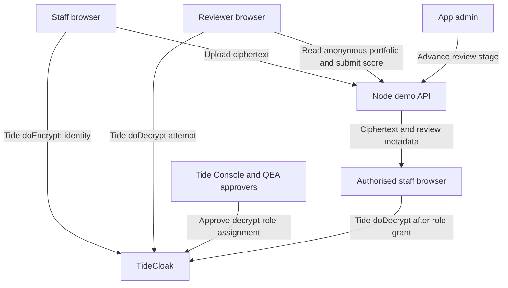

[](https://tide.org/tidecloak)

# BlindReview — Blind Portfolio Review

**Judge the work. Not the person.**

## Project overview

**BlindReview is a staged portfolio-assessment prototype that keeps applicants' identities encrypted until an authorised staff member is permitted to reveal them.**

Built with [TideCloak](https://tide.org/tidecloak).

### 1. Vision & originality

BlindReview lets education and recruitment teams assess portfolios on their merits before learning who submitted them. Each submission has an anonymous work sample, assessment criteria and a separate encrypted identity. The workflow moves from **Blind Review → Evaluation Complete → Identity Reveal**.

### 2. Trust constraint insight

Simply hiding a name in the interface is insufficient: privileged application operators may still access the underlying data. BlindReview separates evaluation content from identity ciphertext and withholds the Tide decryption role during blind review, so UI visibility alone cannot grant access.

### 3. Value & impact

Students and applicants receive a fairer first assessment, while reviewers can focus on demonstrated skills and evidence. For example, an assessor can score an NLP project without seeing the applicant's name or email.

### 4. Why TideCloak matters

TideCloak provides authentication, role-based access and browser-side, tag-based encryption/decryption. The API receives ciphertext rather than the original identity. A permitted reveal requires the appropriate Tide decryption role; granting that role can be governed by **Quorum-Enforced Approvals (QEA)** instead of one administrator acting alone.

### 5. Prototype & storytelling

The demo shows staff encrypting a synthetic identity, a reviewer submitting an anonymous score and failing to decrypt it, an administrator advancing the review, and authorised staff revealing the identity **only after the appropriate Tide role is approved and assigned**.

## Demo video

[View the demo video](./Video.mp4) (included in the project directory). The recording should demonstrate the denied and permitted decryption attempts using real TideCloak accounts.

## Implemented prototype

- **TideCloak sign-in** through `@tidecloak/react`, with roles read from Tide-issued tokens.
- **Three sample portfolios:** `P-001` (NLP classifier), `P-002` (campus accessibility), and `P-003` (network-log anomaly detection).
- **Identity sealing:** the browser calls `doEncrypt()`; the API stores the resulting ciphertext, not the raw name or email.
- **Blind assessment:** reviewers submit a score from 1–5 and written feedback. The API allows one review per reviewer per portfolio.
- **Review stages:** `blind_review` → `evaluated` → `identity_reveal`; a review must exist before advancement.
- **Identity reveal attempt:** the app calls Tide's actual `doDecrypt()`, not a simulated permission check.
- **Audit trail:** review submissions, identity uploads and stage changes are recorded by the demo API.

## Technology

| Component | Implementation |
| --- | --- |
| Frontend | React 19, Vite 6, JavaScript |
| Identity, roles and cryptography | TideCloak React SDK (`@tidecloak/react`) |
| Backend | Node.js HTTP API (`server/index.mjs`) |
| Data | Synthetic portfolios; in-memory API storage |
| Local authentication server | TideCloak development server via Docker |

## Local setup

### Prerequisites

- Node.js **20 or newer** and npm.
- Docker Desktop with a running Docker engine.
- A TideCloak realm and app configured for this prototype, with enrolled test accounts.

### 1. Clone and install

```powershell
git clone https://github.com/truongnguyenxuanvinh/hackathon.git
cd hackathon
npm install
```

### 2. Start TideCloak

If you already have a working TideCloak container, start or reuse it. Otherwise:

```powershell
docker run --name mytidecloak -d -p 8080:8080 `
  -e KC_BOOTSTRAP_ADMIN_USERNAME=admin `
  -e KC_BOOTSTRAP_ADMIN_PASSWORD=password `
  tideorg/tidecloak-dev:latest
```

Open <http://localhost:8080> and finish the initial Tide realm setup and enrolment. The example credentials above are **for local development only**.

Configure a TideCloak application with these local frontend settings:

- **Valid redirect URIs:** `http://localhost:5137/*`
- **Web origins:** `http://localhost:5137`
- **Adapter file:** download the Tide adapter as `public/tidecloak.json`.

> **Important:** `vite.config.js` reads `public/tidecloak.json` when Vite starts, and `src/main.jsx` loads it at runtime. The app will not start correctly without a valid adapter file. This file is excluded from Git by `.gitignore`.

The current API defaults expect realm **`blind`** and client **`blind-client`**. If yours differ, use the environment overrides below and ensure the downloaded adapter refers to the same Tide realm/app.

### 3. Configure demo roles

Using Tide Console, create/assign the following **realm roles** and approve governed changes in QEA as required:

| Account | Initial roles | Purpose |
| --- | --- | --- |
| Staff (`staff01`) | `staff`, `_tide_identity.selfencrypt` | Seal `P-001`'s synthetic identity |
| Reviewer (`reviewer01`) | `reviewer` | See anonymous work and submit a score; **no decrypt role** |
| Admin (`admin01`) | `blind_admin` | Advance review stages in the application |
| Staff after approval | `staff`, `_tide_identity.selfdecrypt` | Decrypt `P-001` at the reveal stage |

An alternative submission account can have `blind_submitter` and `_tide_identity.selfencrypt`. Do **not** assign `_tide_identity.selfdecrypt` to the reviewer, default roles or staff before the reveal stage. `P-001` deliberately uses the existing `identity` encryption tag for the demo.

To demonstrate **two-admin approval**, configure **three** `tide-realm-admin` holders in the Tide realm, then approve the role assignment through the Tide Console **QEA Approvals** screen. An ordinary `blind_admin` application role is not automatically a QEA administrator.

> `scripts/provision-roles.mjs` is a development helper, **not a prerequisite**. Its legacy role/tag names differ from those currently checked by `src/App.jsx` and `server/index.mjs`; review and align it before use. Manual setup in Tide Console is the recommended hackathon path.

### 4. Start the API and frontend

Open **two PowerShell terminals** inside the project directory.

**Terminal A — demo API (port 8787):**

```powershell
node server/index.mjs
```

**Terminal B — Vite frontend (port 5137):**

```powershell
npm run dev
```

Open **<http://localhost:5137>**. The TideCloak server runs at <http://localhost:8080>; the local demo API runs at <http://localhost:8787>.

If the Tide realm, client or frontend origin differs from the defaults, set these in Terminal A **before** starting the API:

```powershell
$env:TIDE_ISSUER = 'http://localhost:8080/realms/blind'
$env:TIDE_CLIENT_ID = 'blind-client'
$env:FRONTEND_ORIGIN = 'http://localhost:5137'
node server/index.mjs
```

The values above are the current defaults; replace them only if your Tide configuration is different.

## Architecture and security boundaries



### Scope and limitations

- **Stage advancement is an API role check**, not itself a Tide QEA-governed action. The app's stage alone does not grant or revoke cryptographic access. The relevant Tide decrypt role must remain withheld until authorisation at the reveal stage.
- **QEA protects the configured Tide role change.** A multi-admin quorum is only demonstrated if the realm really has the required enrolled administrators and the request is approved through Tide.
- **Data is stored in memory.** Restarting `server/index.mjs` resets portfolios, ciphertext, reviews and audit entries. There is no production database or durable audit log.
- **The API validates signed Tide JWTs and realm roles, but does not validate DPoP possession proofs.** This is a hackathon demonstration, **not a production-grade resource server**.
- **Tag scope matters.** `P-001` uses the `identity` tag; `P-002` and `P-003` use `identity_p002` and `identity_p003`, which need corresponding Tide encrypt/decrypt roles if demonstrated.
- **Only synthetic data.** Do not upload real identities or sensitive portfolios. Revoking future access cannot retract information that someone has already viewed or copied.

## Documentation

- [TideCloak](https://tide.org/tidecloak)
- [TideCloak React SDK](https://docs.tide.org/Languages/React/tidecloak-react-intro)
- [Tide E2EE setup](https://docs.tide.org/Admin/e2ee)
- [Quorum-Enforced Approvals (QEA)](https://docs.tide.org/Admin/SetupIGA)
